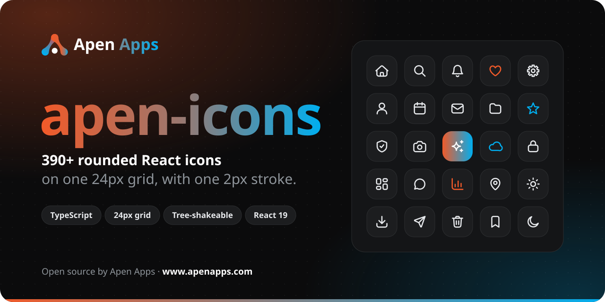

<p align="center">
  <a href="https://www.apenapps.com">
    
  </a>
</p>

<p align="center">
  <a href="https://www.npmjs.com/package/apen-icons"></a>
  <a href="https://www.npmjs.com/package/apen-icons"></a>
  
  <a href="LICENSE"></a>
</p>

<p align="center">
  <a href="#quick-start">Quick start</a> ·
  <a href="#props">Props</a> ·
  <a href="#styling">Styling</a> ·
  <a href="#categories">Categories</a> ·
  <a href="#design-rules">Design rules</a> ·
  <a href="#adding-an-icon">Adding an icon</a> ·
  <a href="https://www.apenapps.com">apenapps.com</a>
</p>

---

```bash
npm install apen-icons
```

Apen Icons is a set of 1,000 rounded React icons. Every icon is drawn on the same 24px grid with the same 2px rounded stroke, so they sit together in buttons, menus and dashboards.

- **Consistent:** one grid, one stroke and one corner style. A build step checks every icon against these rules.
- **Tree-shakeable:** each icon is its own named export. Importing `Home` adds less than 1 KB.
- **Easy to style:** icons draw with `currentColor`, so `className="text-primary"` or the `color` prop just works.
- **Accessible:** decorative by default (`aria-hidden`). Pass `title` and the icon is announced with that name.
- **Typed:** written in TypeScript. Every icon shares one `IconProps` type, and your editor shows a preview on hover.
- **Made for [Apen UI](https://github.com/ibrarli/apen-ui):** same rounded look, and the default icon set for its components.

Built by [Apen Apps](https://www.apenapps.com). Pairs with [create-apen](https://www.npmjs.com/package/create-apen), which scaffolds full-stack projects.

## Quick start

You need React 19.

```bash
npm install apen-icons
# or
pnpm add apen-icons
yarn add apen-icons
bun add apen-icons
```

```tsx
import { Bell, Heart, Search } from 'apen-icons';

export function Toolbar() {
  return (
    <div className="flex gap-3">
      <Search />
      <Bell size={20} strokeWidth={1.5} />
      <Heart color="#f15a29" title="Favourite" />
    </div>
  );
}
```

Browse every icon, adjust size, stroke and colour, and copy the JSX or SVG on the website (`npm run dev`).

Plain SVG files ship with the package too, for non-React projects:

```ts
import bellUrl from 'apen-icons/icons/bell.svg';
```

## Props

| Prop | Type | Default | |
| --- | --- | --- | --- |
| `size` | `number \| string` | `24` | Width and height. Numbers are pixels. |
| `color` | `string` | `currentColor` | Stroke colour. Solid icons (`*Fill`) use it as their fill. |
| `strokeWidth` | `number \| string` | `2` | Line thickness on the 24px grid. |
| `absoluteStrokeWidth` | `boolean` | `false` | Keep the stroke in screen pixels at any size. |
| `title` | `string` | | Accessible name. Without it the icon is hidden from screen readers. |
| `...props` | `SVGProps` | | `className`, `style`, `onClick` and any other SVG attribute. |

## Styling

Icons take their colour from the text around them, so they follow your theme without any setup:

```tsx
<button className="text-primary hover:text-primary/80">
  <Download className="size-4" /> Export
</button>
```

Every icon also gets the classes `apen-icon` and `apen-icon-<name>` (for example `apen-icon-arrow-right`), so you can style all of them, or one of them, from CSS:

```css
.apen-icon { stroke-width: 1.75; }
.apen-icon-heart { color: #f15a29; }
```

A 2px stroke looks heavy on a large icon and thin on a small one, because the stroke scales with the icon. `absoluteStrokeWidth` keeps it at the same screen thickness:

```tsx
<Sparkles size={48} absoluteStrokeWidth />   {/* 2px lines, not 4px */}
```

Solid icons end in `Fill` and take the same props:

```tsx
<Star /> <StarFill color="#f5a524" />
```

An icon on its own, with no visible label, needs a name for screen readers:

```tsx
<button aria-label="Delete"><Trash /></button>   {/* the button is named, the icon stays hidden */}
<CircleCheck title="Payment received" />         {/* the icon is named */}
```

## Categories

1,000 icons in 26 categories. Search and filter them on the website (`npm run dev`).

| Category | Icons | Category | Icons |
| --- | --- | --- | --- |
| Social | 80 | Commerce | 35 |
| Arrows | 79 | Development | 32 |
| Media | 73 | Users | 32 |
| Actions | 61 | Time | 28 |
| Layout | 59 | Nature | 27 |
| Devices | 53 | Charts | 23 |
| Communication | 52 | Alerts | 21 |
| Files | 50 | Food | 20 |
| Maps | 39 | Home | 20 |
| Security | 39 | Tools | 20 |
| Text | 39 | Design | 18 |
| Shapes | 37 | Health | 15 |
| Weather | 36 | Education | 12 |

The category, search tags and first version of every icon are in `apen-icons/meta.json`, which is handy for building your own icon picker:

```ts
import meta from 'apen-icons/meta.json';

meta['bell']; // { category: 'Alerts', tags: [...], since: '1.2.0' }
```

## TypeScript

```tsx
import { createIcon, type ApenIcon, type IconProps } from 'apen-icons';

// Accept any icon as a prop
function NavItem({ icon: Icon, label }: { icon: ApenIcon; label: string }) {
  return <a><Icon size={18} /> {label}</a>;
}

// Make your own icon that behaves like the rest of the set
export const Logo = createIcon('Logo', [
  ['circle', { cx: '12', cy: '12', r: '10' }],
  ['path', { d: 'M8 12h8' }],
]);
```

## Design rules

| Rule | Value |
| --- | --- |
| Canvas | 24 × 24, `viewBox="0 0 24 24"` |
| Live area | 20 × 20 (2px padding on every side) |
| Stroke | 2px, `currentColor`, round caps, round joins |
| Corners | 3–4px radius on large containers, 1–2px on small parts |
| Circles | Full-size circles use `r="10"`; full-size squares are 18 × 18 |
| Modifiers | Inside the shape when there is room (Home, Shield, File, Calendar, Circle). Otherwise a badge in the bottom-right corner (User, Funnel) |
| Solid icons | Separate icons named `*Fill`, drawn on the same outline as the stroke version |

## Upgrading from 1.1.x

Version 1.2.0 redraws every icon on the 24px grid, so they now share one size and one stroke. All existing names still work, so nothing breaks. Some duplicates were merged; the old names remain as **deprecated aliases** until 2.0, and your editor will strike them through:

| Old name | Use instead |
| --- | --- |
| `Cross` | `X` |
| `CircleCross` | `CircleX` |
| `Dash` | `Minus` |
| `SquareOutline` | `Square` |
| `Kebab`, `KebabMenu` | `MenuKebab` |
| `User2` | `User` |
| `Eye2` | `Eye` |
| `Moon2` | `Moon` |
| `VideoCamera` | `Video` |
| `Joystick2` | `Joystick` |
| `Home2` | `Home` |
| `Home2Plus`, `Home2Minus`, `Home2Check`, `Home2X`, `Home2Pen`, `Home2Alert`, `Home2One`, `Home2Two` | `HomePlus`, `HomeMinus`, `HomeCheck`, `HomeX`, `HomePen`, `HomeAlert`, `HomeOne`, `HomeTwo` |

Icons that used to be solid (`Search`, `Settings`, `Folder`, `Play`, `Pause`, `Bookmark` and others) are now outlined, like the rest of the set. Use `PlayFill`, `PauseFill`, `BookmarkFill`, `StarFill`, `HeartFill`, `SparkleFill` or `PaletteFill` when you want a solid icon.

`Bolt` is now a lightning bolt, to match its `flash` / `energy` tags.

The full list of changes is in the [changelog](CHANGELOG.md).

## Adding an icon

The SVG files in [`icons/`](icons) are the source of truth. The React components are generated from them, so you never write a component by hand.

1. **Draw** the icon in Figma (or any editor) on a 24 × 24 frame. Use 2px strokes, round caps and joins, and keep shapes inside the 20 × 20 live area. Start from a similar icon in `icons/` so it matches.
2. **Export** it as SVG and save it as `icons/<kebab-name>.svg`, for example `icons/cloud-off.svg`. The file name becomes the component name (`CloudOff`).
3. **Clean** the file so it looks like the others: the `<svg>` root attributes below, then only `path`, `circle`, `rect`, `ellipse`, `line`, `polyline` or `polygon` elements. No groups, transforms, ids, styles or hard-coded colours.

   ```svg
   <svg xmlns="http://www.w3.org/2000/svg" width="24" height="24" viewBox="0 0 24 24" fill="none" stroke="currentColor" stroke-width="2" stroke-linecap="round" stroke-linejoin="round">
     <path d="..."/>
   </svg>
   ```

4. **Describe** it in [`icons/meta.json`](icons/meta.json) with a category, a few search tags and the version it ships in:

   ```json
   "cloud-off": { "category": "Files", "tags": ["offline", "sync", "disconnected"], "since": "1.3.0" },
   ```

5. **Check** it: `npm run icons` validates every file, then generates `src/generated/icons.ts`. `npm run dev` shows it on the website straight away.

If the check fails it tells you which file and what to fix, for example `cloud-off.svg: <path> may not set "stroke"`.

To rename an icon without breaking anyone, rename the file and add the old name to `"aliases"` in `meta.json`. It stays exported as a deprecated alias.

## Development

```bash
npm install
npm run dev            # website with live icons, on http://localhost:5173
npm run icons:check    # validate icons/ without writing files
npm run lint           # eslint
npm run typecheck      # tsc
npm run build          # library (dist/) and website (website/dist/)
```

```
icons/              source SVGs and meta.json (edit these)
scripts/            build-icons.mjs: validates icons and generates components
src/createIcon.ts   the shared React component every icon uses
src/generated/      generated icon exports (git-ignored, never edit)
website/            showcase site (Vite, React, Tailwind v4, Apen UI tokens)
```

## License

MIT © [Apen Apps](https://www.apenapps.com)
